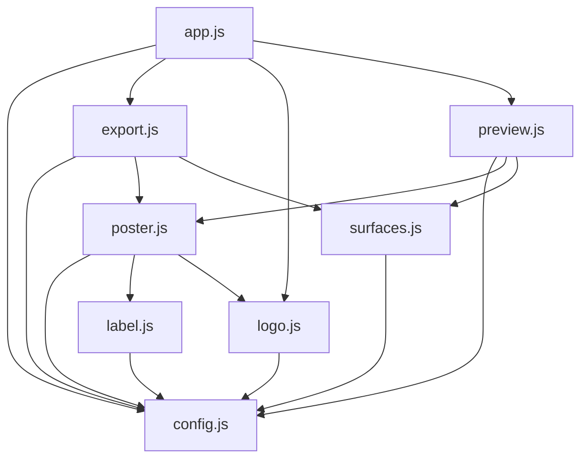

# Agent notes

Static site, no build step, no package manager, no test suite. Everything shipped here
is served exactly as it sits on disk, so a change is live the moment it is saved.

`README.md` is the human-facing overview. This file is how the repo is put together,
where the design constants live, and the rules that keep the preview and the export in
agreement. Read both before changing the tool.

## Layout

The root holds only the page and its styling. There are eight JS modules with one job
each: the code is in `js/`, the artwork in `img/`, and `js/config.js` is the only place
numbers live.

| Path                               | Purpose                                                                          |
| ---------------------------------- | -------------------------------------------------------------------------------- |
| `index.html`                       | The page: markup and links only. No styles or script inline.                     |
| `styles.css`                       | Page styling.                                                                    |
| `js/config.js`                     | Every constant: sizes, crops, colours, the design, the field, the export.        |
| `js/surfaces.js`                   | Canvas plumbing: a context that draws in poster units at any pixel size.         |
| `js/logo.js`                       | The artwork: fetch, normalise, decode, and draw `img/ai5nines.svg`.              |
| `js/label.js`                      | The `#N` mark: measure it, fit it, draw it centred on its ink.                   |
| `js/poster.js`                     | The design: where the wordmark and the number sit. The layout, and nothing else. |
| `js/preview.js`                    | The page's canvases: the poster preview and the Crops row.                       |
| `js/export.js`                     | The export: raster the poster, then download it or copy it to the clipboard.     |
| `js/app.js`                        | The wiring: the field, the buttons, the status line, start-up.                   |
| `img/ai5nines.svg`                 | Brand artwork. The single source of truth for the logo.                          |
| `img/ai5nines-512.png`, `-128.png` | Raster copies. `128` is used as the page favicon.                                |
| `CNAME`                            | Tells GitHub Pages to serve this site at `assets.ai5nines.com`.                  |
| `.nojekyll`                        | Stops Pages from running Jekyll over the published files.                        |

The dependencies run one way, so nothing has to be read twice to follow it. All of these
are files in `js/`:



## The rules

- **`js/config.js` is the only place numbers live** — sizes, crops, colours, the design,
  the field, the export — so a tune-up is a config edit and never a hunt.
- **One job per module, and dependencies run one way.** `js/poster.js` is the layout and
  must not reach for page elements; `js/app.js` is only the wiring. Keep those
  boundaries, and no styling or script belongs back in the HTML.
- **`img/ai5nines.svg` is brand artwork, not a build input.** The page reads it at
  runtime. Never rewrite it from inside the tool, and never edit it to make a layout work
  — adjust the `DESIGN` constants in `js/config.js` instead.
- **The poster is cropped, not just scaled.** See below.
- **The preload in `index.html` is coupled to `js/logo.js`.** It only helps while the
  path it preloads matches how the artwork is actually fetched. See below.

### The frames Substack crops into

Because the publication's home page uses the **newspaper** layout, three of these apply
on top of the email:

| Frame            | Substack size | Ratio  |
| ---------------- | ------------- | ------ |
| Square thumbnail | 66×66         | 1:1    |
| List thumbnail   | 162×120       | 1.35:1 |
| Lead image       | 626×418       | 1.5:1  |
| Email and social | 1200×630      | 1.9:1  |

Every frame is narrower than the poster, so a crop keeps the full height and only trims
the sides. The narrowest frame therefore decides how much width survives — 630 of the
poster's 1200 units — and the lockup is laid out centred inside that. `CROPS` in
`js/config.js` is the single source of truth for the list and `SAFE_WIDTH` derives from
it, so removing a frame widens the design's room without touching the layout.

Substack also has a **Cropping** setting (Website editor → Home page) whose `center` and
`smart` modes decide _where_ a crop is taken from. Centre cropping is what the safe area
assumes.

### Why the logo is preloaded

`index.html` preloads `img/ai5nines.svg` with `as="fetch" crossorigin`. Both parts
matter, because the artwork is read as _text_ by `fetch()` in `js/logo.js` rather than
drawn straight from an ``:

- `as="image"` would prime a different cache entry and cost a **second** download.
- Dropping `crossorigin` produces a request whose credentials mode does not match the
  `fetch()`, so the browser downloads the file twice and logs a warning.

The preload `href` and `LOGO.src` in `js/config.js` are two copies of the same path,
resolved against the page, and **must stay identical** — a preload for a different URL
silently stops helping and costs the second download it was added to avoid.

If the way the artwork is loaded ever changes, change the preload to match.

## Editing the design

Everything about how the poster looks lives in `js/config.js`: the `POSTER` size,
`CROPS`, `COLORS`, `LABEL`, `LOGO`, `DESIGN` and `FONT`. `js/poster.js` holds the layout
that arranges them, `js/label.js` the `#N` mark and `js/logo.js` the artwork, so
`drawPoster()` reads as the design and nothing else.

Three rules keep the design honest:

- **One drawing path.** `drawPoster()` renders the on-screen preview, the export and
  every crop preview, onto surfaces of different pixel sizes. Never add a separate
  preview- or export-only drawing path, or the two will drift apart. The two hand-offs
  share one raster — `renderPngBlob()` in `js/export.js` — so a saved file and a copied
  image can never disagree either.
- **Fixed poster space.** The design is authored in a 1200×630 space and scaled to
  fit the target surface, so every measurement is in the same units. Only the export
  surface is ever exactly 1200×630.
- **Stay inside the safe area.** All content must fit `SAFE_WIDTH`, centred. Anything
  outside it is cut by the narrowest frame Substack uses, so the only way to buy the
  design more room is to change `CROPS`.

## Code style

- Tabs for indentation.
- Single quotes.
- No semicolons.
- Named constants instead of repeated literals and magic numbers.

There is no formatter config in this repo, so an editor running Prettier with its
defaults will rewrite files to 2 spaces, double quotes and semicolons and fight this.
Pin the style with a config if that gets in the way.

## Serving it locally

The page cannot be opened from disk — browsers block `fetch()` of the SVG over
`file://`. Live Server serves this repo on port 5500; otherwise:

```
python3 -m http.server 8000
```

Then load <http://localhost:8000/>. Under Live Server the page holds a live-reload
websocket, so a browser automation wait on `networkidle` never resolves against port
5500 — wait on `load` instead.

## Verifying a change

Confirm the preview draws and that the Crops row is whole in the narrowest frame, then
check that a download is exactly 1200×630. ImageMagick is not installed here, so read
the size straight out of the PNG header instead:

```
python3 -c "import struct,sys; d=open(sys.argv[1],'rb').read(24); print('%dx%d' % struct.unpack('>II', d[16:24]))" ai5nines-issue-13.png
```

## Publishing

1. Push to the branch configured under _Settings → Pages_.
2. DNS: a `CNAME` record for `assets` pointing at `<owner>.github.io`. It must be
   DNS-only — a Cloudflare-style orange-cloud proxy in front of it breaks the
   certificate.
3. In _Settings → Pages_, set the custom domain to `assets.ai5nines.com` and enable
   **Enforce HTTPS**.

Note that GitHub Pages on a **private** repository needs a paid plan (Pro, Team or
Enterprise).

The tool is intentionally excluded from search engines via a `noindex` meta tag while
it is hosted on a public Pages site.
